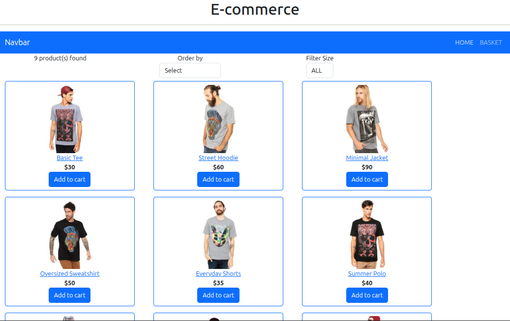
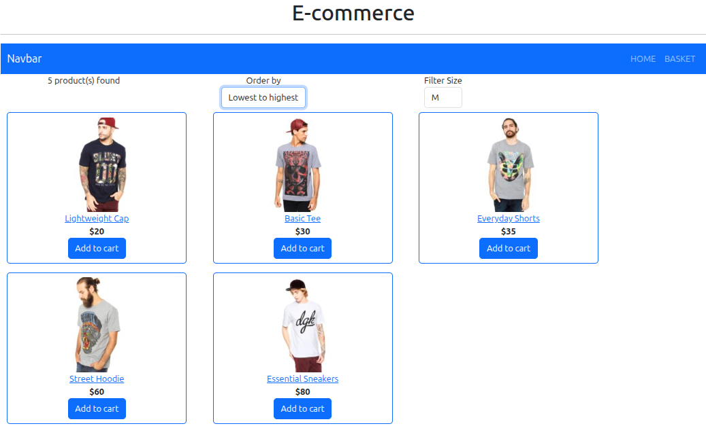
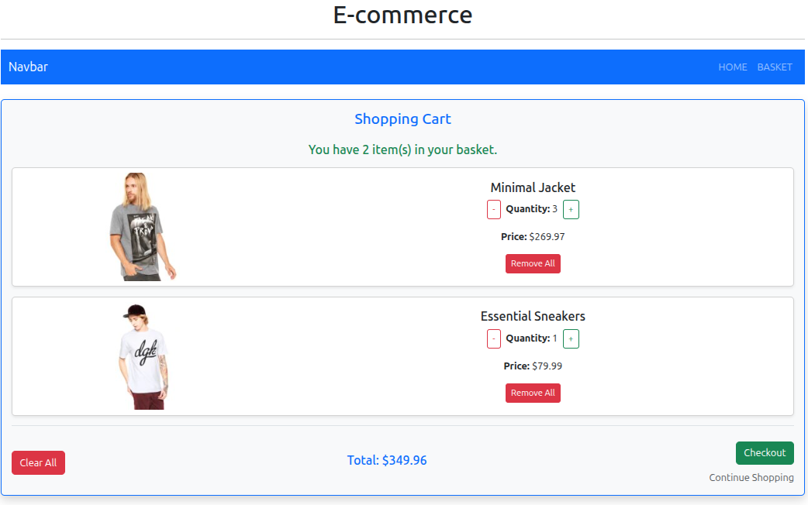

# React E-Shop

A small e-commerce demo built with React. It covers a typical shop flow: browse products, filter/sort, add items to a basket, adjust quantities, and see totals.

## Features
- Product grid with images, titles, and prices
- Filter by size (XS–XXL)
- Sort by price (lowest → highest / highest → lowest)
- Add items to basket, increase/decrease quantity, remove items
- Clear basket + basket total calculation
- Basket items persist via LocalStorage
- Client-side routing: Home (Products) / Basket

## Tech stack
- React (Create React App)
- React Router
- Redux Toolkit (products + cart slices)
- Bootstrap 5

## Data source (reliable / offline-friendly)
Products are loaded from a local JSON file (instead of an external API) to keep the demo stable:

- `public/data/products.json`

Product images are served from:
- `public/products/<sku>_2.jpg`

## Run locally

### With Yarn (recommended if you keep `yarn.lock`)
```bash
yarn install
yarn start
```

### With npm
```bash
npm install
npm start
```

Then open:
- http://localhost:3000

## Project structure (high level)
```txt
src/
  App.js
  store.js
  productSlice.js
  cartSlice.js
  components/
    NavBar.jsx
    Products.js
    Filter.js
    Basket.js
  util.js
public/
  data/products.json
  products/
```

## Notes
- This is a learning/demo project. “Checkout” is a placeholder (no real payment processing).
- Cart items are stored in LocalStorage, so they remain after refresh (same browser/device).

## Screenshots




## License
See `LICENSE`.